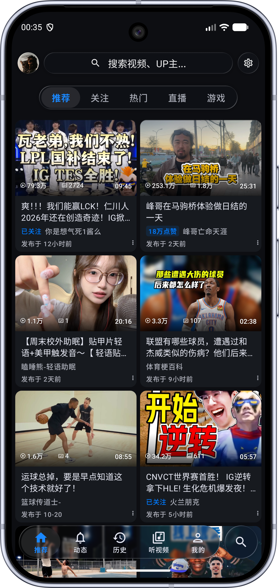
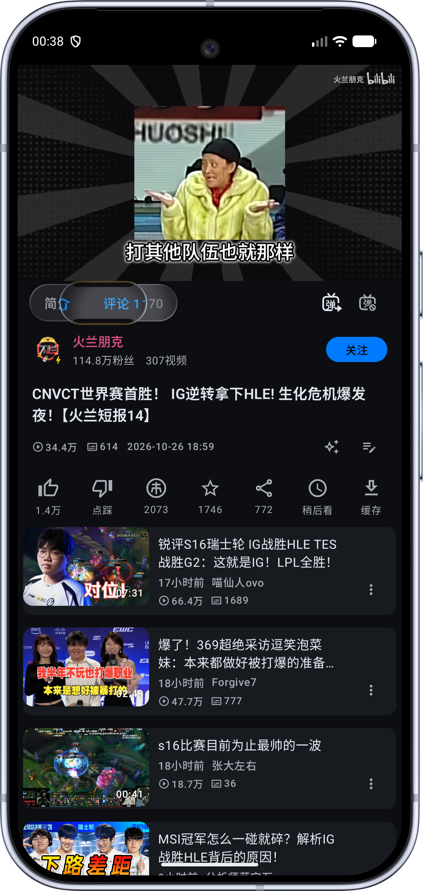

<div align="center">


# BiliPai

**A native, clean and extensible BiliBili client for Android**

[简体中文](README.md) · [English](README_EN.md)


[Download](#download) · [Telegram channel](https://t.me/bilipai666) · [Telegram group](https://t.me/bilipai888/1)

</div>

Built with Kotlin and Jetpack Compose, BiliPai supports videos, bangumi, live streams, feeds, messages and offline downloads, adapting to phones, tablets and foldables.

## Features

| Feature | Details |
| --- | --- |
| Playback | DASH, HD quality, danmaku, gestures, speed controls, resume, background play and picture-in-picture |
| Audio mode | Immersive and vinyl layouts, lyrics, queues, sleep timer and system media controls |
| Subtitles and notes | Local subtitle import/export, styling and timing; private notes, timestamps and AI-summary drafts |
| Bangumi and live | Following, episode selection, seek previews, live categories and danmaku |
| Feeds and messages | Followed creators, comments, replies, image previews and direct messages |
| Search and downloads | Video, creator and bangumi search; resumable downloads and local playback |
| Appearance | Google Material 3, Miuix, optional Liquid Glass, dynamic colors and large-screen layouts |
| Extensions | Plugins, DLNA / Google Cast and WebDAV settings backup |

Some quality tiers require login or account privileges. Appearance, playback, danmaku and background behavior are configurable in Settings.

## Preview

<div align="center">

**Liquid Glass, throughout the app**

Live-sampled liquid glass across top bars, docks, menus and player controls — refracting with content, springing on touch, switching back to native Google Material 3 / Miuix anytime. Screenshots show a few scenes only.






</div>

Appearance varies by version, theme and screen size.

Beyond the screenshots: tap-to-act danmaku, swipe-up fullscreen with ambient light in portrait playback, audio mode, AI note summaries, subtitle import/export, plugins, DLNA / Google Cast casting, WebDAV settings backup and more; some features vary with the Android version.

## Download

Get APKs and release notes from the [Telegram channel](https://t.me/bilipai666). Join the [Telegram group](https://t.me/bilipai888/1) for feedback.

- Requires Android 8.0+
- Sign in with a TV QR code, password, SMS code or imported cookies
- Allow installation from the source used to open the APK

## Plugins

The 12 built-in plugins cover sponsor skipping, ad filtering, Anime4K, danmaku, eye care, recommendations and casting. Import JSON / `.bp` rules by URL.

Review the source and declared permissions before importing third-party plugins. For plugin development, see [plugin-sdk](plugin-sdk).

## Recent updates

- Swipe up in portrait playback for fullscreen with dynamic ambient light; tap a danmaku to like, copy or report it.
- New advanced live danmaku options for typography and spacing, with rich-text input and emoji in the editor.
- Audio mode now remembers playback progress more reliably; the profile page adds coin/XP details and more privacy settings.

See [CHANGELOG.md](CHANGELOG.md) for details.

## Build

Use JDK 21 and Android SDK 37.

```bash
git clone https://github.com/jay3-yy/BiliPai.git
cd BiliPai
./gradlew :app:assembleDev
```

Miuix dependencies require GitHub Packages access. Set `gpr.user` and `gpr.key` in your local `~/.gradle/gradle.properties`, or use `GITHUB_ACTOR` and `GITHUB_TOKEN`. APKs are exported to `app/build/outputs/bilipai/dev/`. `app/google-services.json` is optional; Firebase is skipped when absent.

## Contributing

Share bugs and ideas through [Issues](https://github.com/jay3-yy/BiliPai/issues/new/choose), or help improve features and translations with a [pull request](https://github.com/jay3-yy/BiliPai/pulls).

## Acknowledgements

- [Kotlin](https://kotlinlang.org/) — language and coroutines
- [Jetpack Compose](https://developer.android.com/jetpack/compose) — declarative UI framework
- [AndroidX Media3](https://github.com/androidx/media) — Media3 / ExoPlayer playback engine
- [FFmpeg](https://ffmpeg.org/) — audio decoding
- [Room](https://developer.android.com/training/data-storage/room) / [DataStore](https://developer.android.com/topic/libraries/architecture/datastore) — local data and preferences
- [Retrofit](https://github.com/square/retrofit) / [OkHttp](https://github.com/square/okhttp) — networking
- [Coil](https://github.com/coil-kt/coil) — image loading
- [Lottie](https://github.com/airbnb/lottie-android) — vector animation
- [MaterialKolor](https://github.com/jordond/MaterialKolor) — dynamic theme colors
- [Compose Rich Editor](https://github.com/MohamedRejeb/Compose-Rich-Editor) — rich text editing
- [DanmakuRenderEngine](https://github.com/bytedance/DanmakuRenderEngine) — danmaku rendering engine
- [BiliBili-API-collect](https://github.com/SocialSisterYi/bilibili-API-collect) — BiliBili API reference
- [BiliBiliSponsorBlock](https://github.com/hanydd/BilibiliSponsorBlock) — sponsor-skip data and API
- [Miuix](https://github.com/compose-miuix-ui/miuix) — UI component library
- [Haze](https://github.com/chrisbanes/haze) — blur effects
- [PiliPlus](https://github.com/bggRGjQaUbCoE/PiliPlus) — overall app interaction reference
- [Bili Pilot](https://github.com/siwei-yuan/bili-pilot) — CDN routing reference

See [third-party notices](THIRD_PARTY_NOTICES.md) for all other dependencies and sources.

## License and disclaimer

Licensed under [GPLv3](LICENSE). When distributing, provide the corresponding source code and retain copyright notices as required by the license.

This is an unofficial client and is not affiliated with BiliBili. Content belongs to its respective rights holders. Follow applicable laws and platform rules. Login information is stored locally; usage statistics can be managed in Settings.

<div align="center">

<sub>Source version 0.6.4 (518) · Updated 2026-10-27 · Made by [YangY](https://x.com/YangY_0x00)</sub>

</div>
